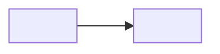

# <Tema>

<La misma definición de `resumen`.>

<Uno o dos párrafos: qué problema resuelve o qué explica, dónde termina y con qué se confunde. La idea que ordena todo el tema.>

## <Título que nombre cómo se compone el sujeto, p. ej. "De qué está hecho el marketing">

<Las verticales como sistema: qué hace cada una y cómo se conectan. Un diagrama Mermaid con un verbo en cada flecha.>

- [<Vertical>](<Vertical>/<vertical>.md) — <qué es y cuándo entrar>.

<Secciones con título propio para las ideas que cruzan todo el tema, si hay: las dos o tres que cambian cómo se lo ve, o un desacuerdo de fondo entre escuelas.>

## <Si el tema se usa para trabajar, las tareas con un título del tema, p. ej. "Qué leer según lo que estés haciendo"; la entrada pasa a `estabilidad: semi`>

- Si tenés que <tarea genérica, sin nombres de empresas>: [<Nota>](<Vertical>/<nota>.md), [<Nota>](<Vertical>/<nota>.md).
- Si tenés que <tarea sin nota propia>: no hay nota todavía; lo más cercano es [<Nota>](<Vertical>/<nota>.md).

## <Si es para aprender, el orden de lectura, con un título del tema, p. ej. "De la célula al organismo">

- [Fundamentos](Fundamentos/fundamentos.md) — <historia, escuelas, fuentes, glosario>.
